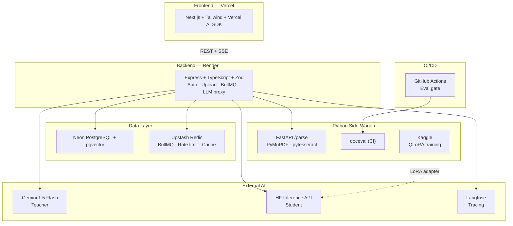

# 03 — Architecture

## Request Flow: Document Upload

1. User uploads a PDF in the Next.js UI.
2. Frontend sends the file to `POST /api/workspaces/:id/upload`.
3. Express stores the file and creates a `documents` row with status `uploaded`.
4. Express enqueues a BullMQ job `{ documentId, workspaceId }`.
5. The BullMQ worker:
   - Fetches document text (via FastAPI `/parse` or local parsing).
   - Builds the extraction prompt.
   - Creates a Langfuse trace and generation span.
   - Calls Gemini 1.5 Flash with JSON mode.
   - Validates the response with Zod.
   - Saves an `extractions` row with latency, cost, and validation status.
   - Updates the document status to `extracted` or `failed`.
   - Ends the Langfuse generation span.
6. Frontend polls or receives an SSE event and renders the extraction.

**Total latency per document:** 1–4 seconds, dominated by the Gemini API call,
not the Express backend.