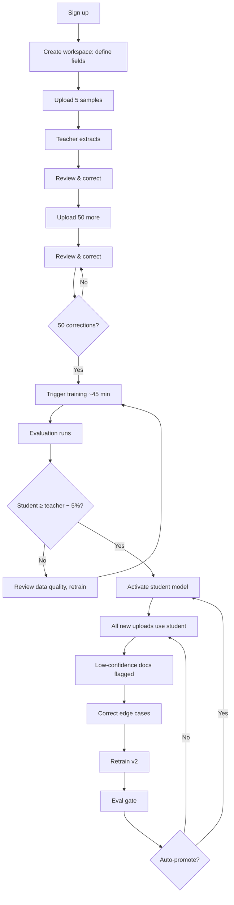

# 08 — User Flow

## Screen Summary

| Phase | Screen | User Does | System Does |
| --- | --- | --- | --- |
| Onboarding | Workspace setup | Selects document type, defines fields, uploads 5 samples | Saves schema, validates samples with teacher |
| Upload | Batch upload | Drags 20–50 files | Queues jobs, respects 15 RPM limit |
| Review | Review queue | Corrects low-confidence fields | Saves gold labels to `corrections` |
| Training | Training dashboard | Waits or navigates away | Runs QLoRA, checkpoints per epoch |
| Evaluation | Model comparison | Reviews accuracy, cost, latency | Runs `doceval` on held-out set |
| Production | Analytics dashboard | Monitors drift | Traces every call in Langfuse |