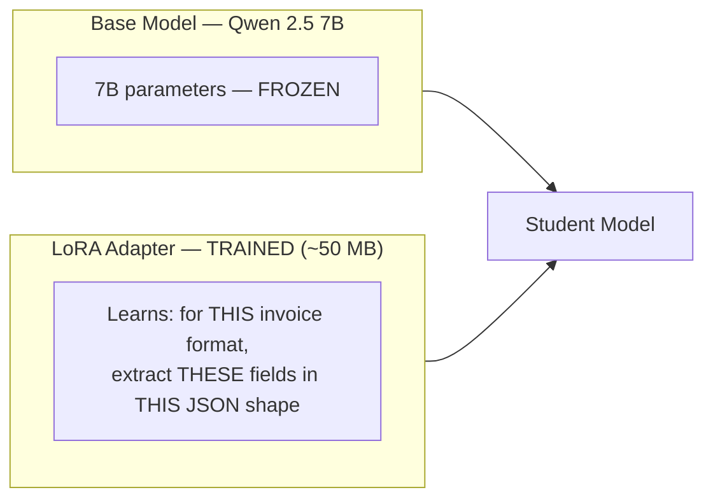

# 09 — Teacher & Student Models

## Teacher: Gemini 1.5 Flash

Large, general-purpose model. Used **only** during data generation.

| Factor | Value |
| --- | --- |
| Cost | ~$0.01–$0.03 per document (paid tier) |
| Latency | 1–3 seconds |
| Accuracy | High (general-purpose) |
| Production use | No |

Teacher output is **not** training data. It may miss fields, hallucinate values,
or format dates inconsistently. The human review step exists to fix this.

```text
Teacher output → human correction → gold training data → student training
```

## Student: Qwen 2.5 7B + LoRA Adapter

Small, open-source model fine-tuned on corrected data. Handles **100% of
production inference**.



QLoRA compresses the base model to 4-bit so a 7B model fits in the **5 GB VRAM**
minimum reported by Unsloth for QLoRA fine-tuning, which is comfortably within
Kaggle’s T4 allocation.

## Comparison

| Metric | Teacher (Gemini Flash) | Student (Qwen 7B + LoRA) |
| --- | --- | --- |
| Parameters | ~200B+ | 7B |
| Cost per 1,000 documents | $10–$30 | $0.50–$2 |
| Latency | 1–3 seconds | 200–500 ms |
| Accuracy on this task | ~95–96% | ~94–96% after fine-tuning |
| Where it runs | Google servers | HF Inference API |
| When used | Data generation | Production |
| Customizable | Prompt only | You own the weights |

## Fine-Tuning Rules

- Only train on **human-corrected** examples.
- Start with **50 examples**, not 500.
- Hold out **20%** of data as a test set before training.
- Compare student and teacher on the **same test set**.
- If the student is worse by more than 5 points, review **data quality** first.